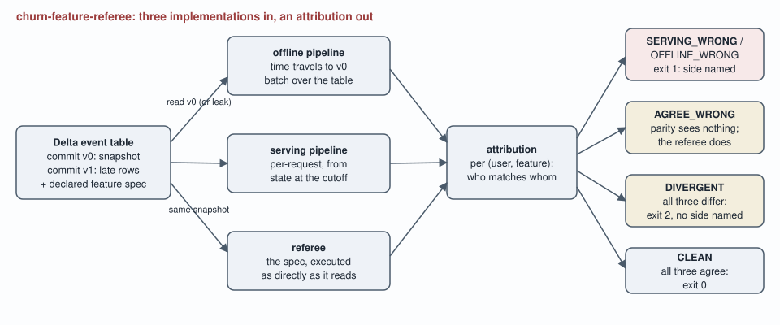

# churn-feature-referee

**A training/serving feature parity referee: a third implementation compiled
from the declared feature spec, used to attribute every mismatch to a side,
and to see the shared bugs a parity check structurally cannot.**

[](https://github.com/lavanyag-wq/churn-feature-referee/actions/workflows/ci.yml)

A training/serving parity check is symmetric. It can detect that the offline
feature store and the online path disagree about a churn feature, and it
structurally cannot say which side computed it wrong, no matter how carefully
its diff is read. And it has a second, worse blindness: when both sides share
the same bug, which is the normal fate of a copy-pasted window helper, they
agree with each other on the same wrong value and the parity check reports
nothing, because agreement is not correctness. This tool supplies what the
diff cannot: a referee implementation written straight from the feature spec,
an attribution class for every (user, feature) pair, and an explicit verdict
for the case where no side can honestly be named.

## The numbers to read first

- **The blind spot, measured.** With the identical strict less-than window
  bug planted on both sides, parity reports 0 mismatches while the referee
  finds 35 wrong pairs across 17 users: 5.8% of all pairs, silently. Across
  five corpus seeds the blind spot covers between 3.5% and 6.5% of pairs.
  Every one of those wrong values trains or scores the churn model
  unchallenged.
- **Attribution, when parity can only shrug.** The planted serving-side
  window bug produces 35 mismatches, and the referee attributes all 35
  mismatches to serving; the as-of-now leak on the offline side corrupts 248
  of the 600 user-feature pairs, and names offline for every one.
- **The referee also knows when it cannot know.** In the messy scenario
  (defects on both sides at once), parity sees 267 mismatches, 276 pairs are
  actually wrong, and 5 pairs where all three implementations disagree are
  reported as DIVERGENT with exit code 2 and nobody named, because a referee
  that guesses is just a third opinion.

Credibility line: 73 tests, 100% line coverage, and every figure in this
document is re-measured by CI and matched against the prose by
`tools/check_numbers.py`. Break one number and the build fails.

## Quickstart

Prerequisites: Python `3.10` or newer. Dependencies are deltalake and pyarrow
(pip wheels, no JVM); nothing needs a network or a key at runtime.

```bash
pip install -e ".[dev]"
feature-referee generate --seed 11 --out /tmp/events
feature-referee audit --table /tmp/events --scenario shared_window
feature-referee audit --table /tmp/events --scenario messy ; echo "exit $?"
make verify   # lint, 73 tests, experiments re-run, every published number re-checked
```

## What each instrument sees, per scenario

One seeded table (120 users, 5 declared features, 600 user-feature pairs),
three implementations, seven scenarios. From `experiments/exp_attribution.py`:

| scenario | planted defect | parity sees | actually wrong | attribution |
| --- | --- | ---: | ---: | --- |
| clean | none | 0 | 0 | CLEAN, exit 0 |
| serving_window | serving: exclusive window | 35 | 35 | 35 serving_wrong |
| null_bug | serving: null default 0 | 7 | 7 | 7 serving_wrong |
| offline_leak | offline: as-of-now anchor | 248 | 248 | 248 offline_wrong |
| offline_tz | offline: one-day shift | 156 | 156 | 156 offline_wrong |
| shared_window | both: same exclusive window | 0 | 35 | 35 agree_wrong |
| messy | both sides, three defects | 267 | 276 | 28 srv, 234 off, 9 agree, 5 divergent |

The shared_window row is the reason this repository exists: the two-sided
check is clean while 5.8% of the feature store is wrong. The null_bug row is
small and nasty in a different way: the 7 never-login users get
days_since_last_login served as 0, which tells the churn model its most
disengaged users logged in today.

## The spec is the contract all three sides serve

Five churn features (logins_30d, watch_minutes_7d, tickets_90d,
active_days_30d, days_since_last_login) declared with the ambiguities that
actually cause skew pinned as rules: a window of W days ending at the cutoff
covers days [cutoff - W + 1, cutoff] inclusive; events after the cutoff never
count (point-in-time rule); absent sources take the declared null default,
never an implicit zero. The generator plants named users on every boundary: a
user whose only login is the cutoff day, a user with logins exactly on and
exactly before the 30-day window's first day, a user who never logs in, and a
user whose only login arrives after the cutoff. Those four users are where
every defect in the table above either shows or hides.

## The offline side is a real Delta table, and the leak is a real leak

The event log is written as a Delta table in two commits: version 0 is the
training snapshot (1522 events at or before the cutoff), version 1 appends
the 29 late-arriving events. The correct offline pipeline time-travels to
version 0. The leak_future defect does what leaky batch jobs do: it reads the
unfrozen table and anchors every window at the newest day it can see instead
of at the label cutoff. Measured against the referee in
`experiments/exp_leak_magnitude.py`, that one line corrupts 248 of the 600
pairs; days_since_last_login goes off by 996 days in the worst case (a
never-login user suddenly has a login), and watch_minutes_7d gains an average
of 122.24 minutes of phantom viewing per corrupted pair. ADR-002 explains why
a plain snapshot file could not even express this bug.

## The bugs the build found

A property test (every watch event carries minutes, nothing else does)
failed against the generator: late-arriving watch events were being written
with zero minutes, so the leak experiment was understating the damage to
watch_minutes_7d. The fix is its own commit, and the leak table above is the
re-measured one.

The commit after it is the second, cheaper lesson: that fix drew one extra
random number per late watch event, which shifted the generator's rng stream,
changed the corpus shape, and landed while a count pinned in a test was
stale, because the suite was run and committed as a chained step instead of
read green first. The repair commit says exactly that, and the convention it
re-learned (verify, read, then commit) is the one this repository now
follows.

## Architecture



Generated by `tools/render_diagram.py`, committed so it renders identically
on GitHub and offline.

## Evidence

Real output (captured verbatim; reproduce with the quickstart commands):

```text
$ feature-referee audit --table /tmp/events --scenario shared_window
scenario: shared_window
verdict: DEFECTS
pairs audited: 600 (120 users x 5 features)
a two-sided parity check would report: 0 mismatches
actually wrong pairs: 35
  serving wrong (offline agrees with referee): 0
  offline wrong (serving agrees with referee): 0
  agree but wrong (parity's blind spot):       35
  divergent (no side can be named):            0
  active_days_30d: agree_wrong 17
  logins_30d: agree_wrong 6
  tickets_90d: agree_wrong 3
  watch_minutes_7d: agree_wrong 9
$ echo "exit $?"
exit 1
```

## What this repository cannot establish

- **Defect rates in any real system.** The event log is synthetic and the
  defects are planted (ADR-001). What transfers is the instrument: the
  attribution machinery, the demonstrated blind spot of two-sided parity, and
  the exit-code contract. The defect shapes themselves (inclusive/exclusive
  windows, as-of-now anchoring, null defaults, day shifts) are claimed as
  common from the feature-skew literature, not measured here.
- **Who is right when all three disagree.** By design: DIVERGENT names
  nobody (ADR-004). In the messy scenario that is 5 pairs where all three
  values differ, and the honest instruction they carry is "read the spec".
- **Sub-day time semantics.** Event time is integer days (ADR-003), so
  windows ending at a time of day and DST behaviour are out of scope by
  declaration.
- **Event-time vs arrival-time snapshots.** Version 0 here is split by event
  time; a real table's commit history is arrival order, and mapping the
  point-in-time rule onto it is integration work the README's future work
  names rather than assumes away (ADR-002).

## Layout, exit codes, reproduction

```
src/churn_feature_referee/   spec, events + Delta io, offline, serving, referee, cli
tests/                       73 property-named tests over the boundary users
experiments/                 attribution, blindspot sweep, leak magnitude
tools/                       collect_metrics, check_numbers, render_diagram
docs/adr/                    four decision records
docs/experiments/            JSON the experiments wrote; CI regenerates it
```

Exit codes of `feature-referee audit`: **0** CLEAN (all three implementations
agree on every pair), **1** DEFECTS (mismatches found and every one
attributed to a side, including the agree-but-wrong class), **2**
UNATTRIBUTED (at least one pair where all three disagree: something is wrong
and no side can honestly be named), **3** error (the tool failed to answer;
never confused with a finding).

Make targets: `lint`, `test`, `experiments`, `receipts`, and `verify`, which
runs all of them from a fresh clone with no network. The number checker
matches anchor phrases rather than bare digits, because a digit match passes
while the sentence around it goes stale.

## Tech stack

| technology | role here | why this one |
| --- | --- | --- |
| deltalake (delta-rs) | the offline event table | the leak under study is a versioned-table leak; a frozen file cannot express it, and time travel makes the correct read one line (ADR-002) |
| pyarrow | columnar io to and from Delta | what deltalake speaks; conversion to plain Python happens at one boundary so the pipelines stay readable |
| stdlib dataclasses + integer days | spec, events, attribution | exact boundary arithmetic a referee can stake authority on (ADR-003) |
| pytest + coverage | 73 tests, 100% line coverage | the boundary users are the worked examples; coverage is measured, not asserted |
| ruff | lint in CI | one tool, one config, line length actually held |

ADRs: [referee authority](docs/adr/ADR-001-referee-authority.md),
[Delta snapshot and the leak](docs/adr/ADR-002-delta-snapshot.md),
[integer days](docs/adr/ADR-003-integer-days.md),
[the DIVERGENT verdict](docs/adr/ADR-004-divergent-verdict.md).

## The pivot, and future work

Intentionally out of scope: streaming the serving side's state from a live
event bus. The trigger for building it is owning an online store whose
contents can drift from the batch table by arrival order, at which point the
referee's comparison becomes three-way in time as well as in value.

Future work: ingesting a real pipeline pair's computed features (the
attribution step already takes plain dicts); an arrival-time mode for
snapshot definition (ADR-002's stated gap); per-feature tolerance in the spec
for float-valued features computed on different hardware; and a trend mode
tracking the agree-wrong count over time, because a rising blind spot is
invisible to every other monitor a feature store has. First metric to watch:
agree_wrong pairs per audit.
